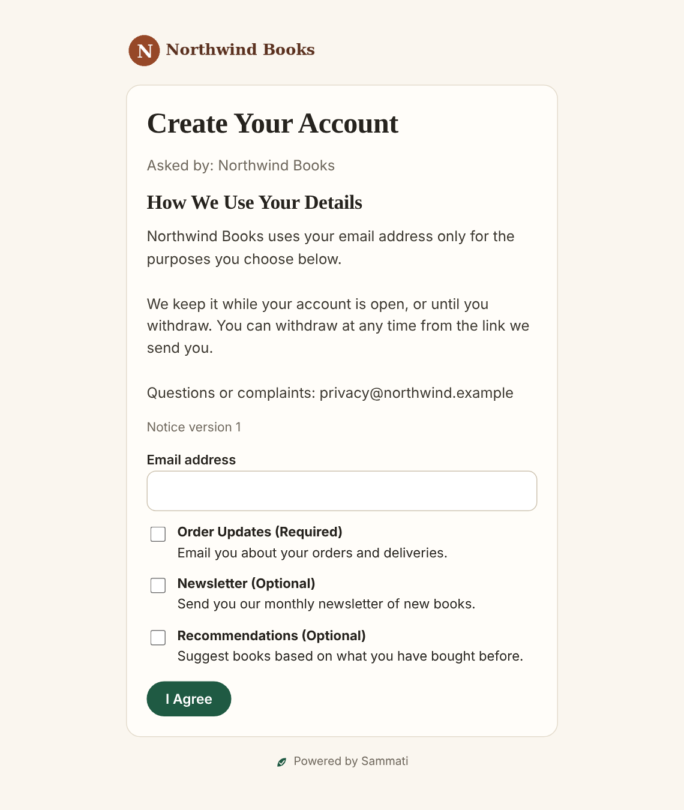
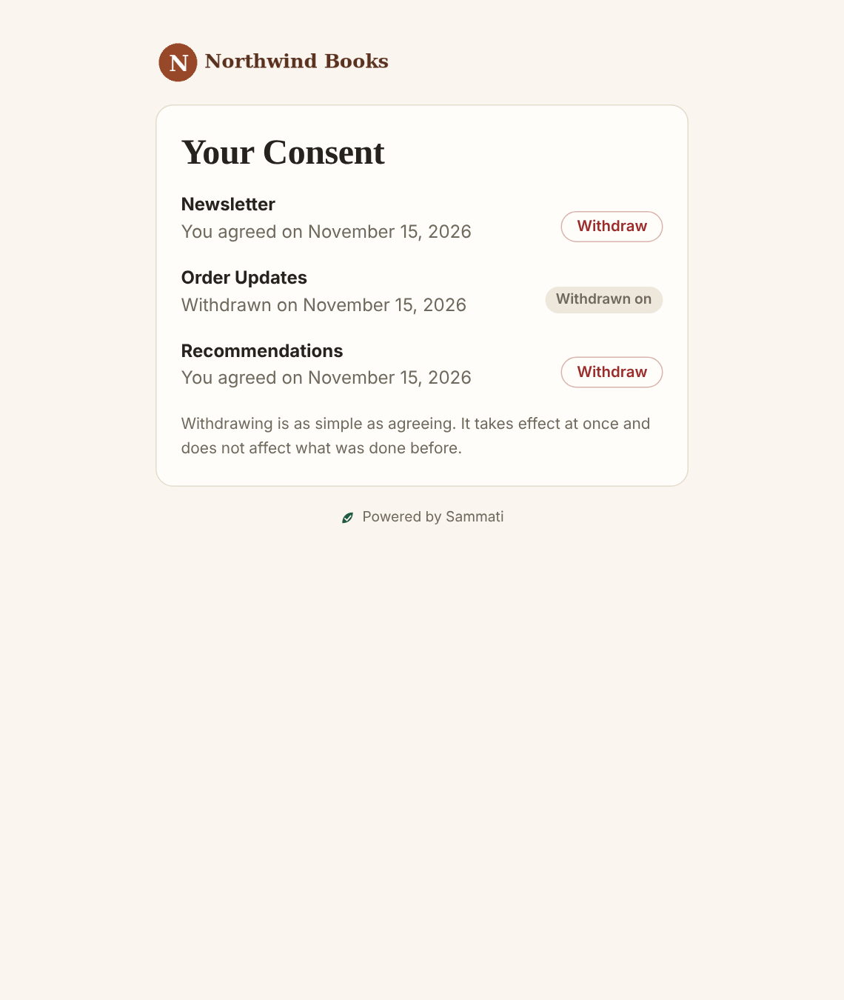
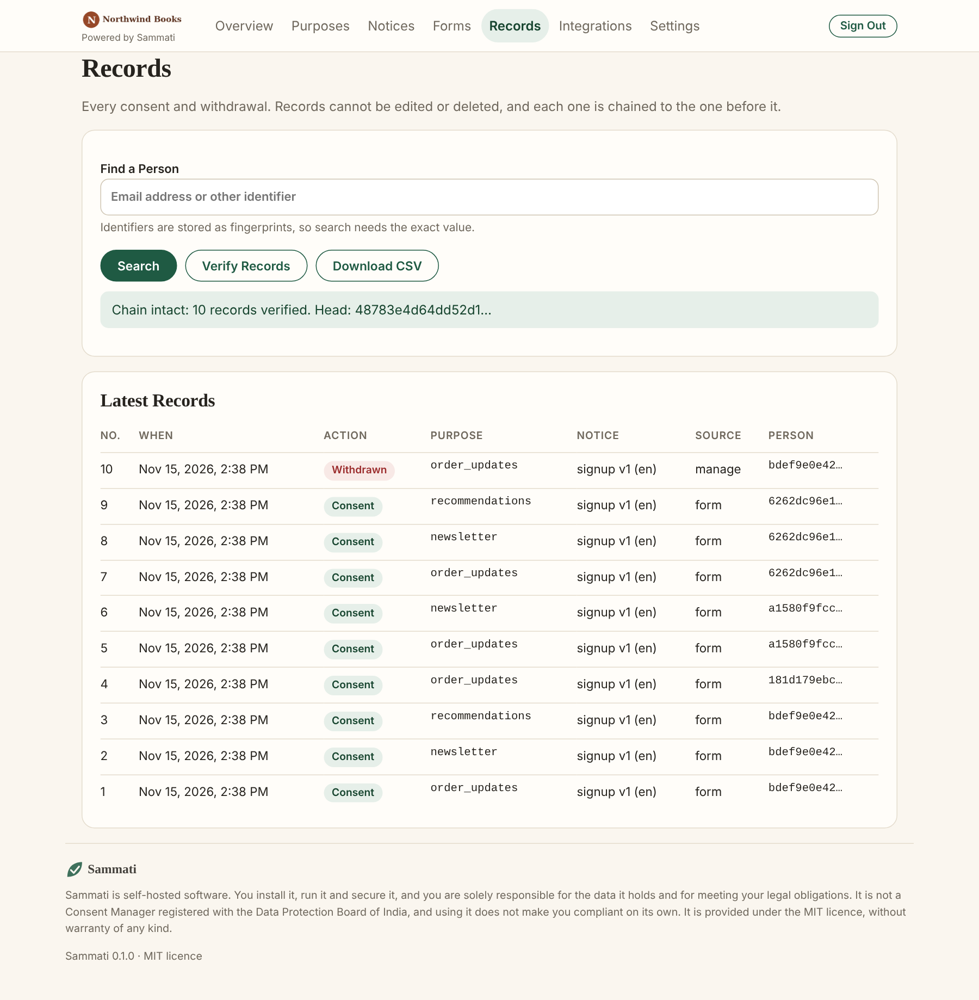
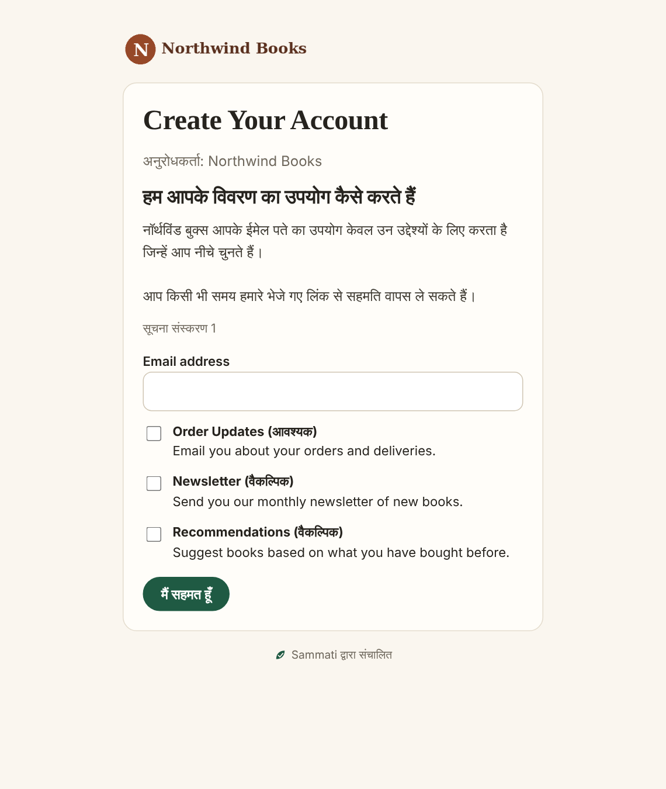
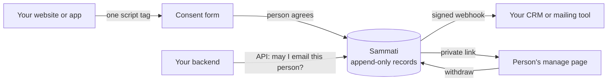

<div align="center">


### Consent your users can see, prove and take back.

A small, self-hosted tool that asks for consent on your website or app,
keeps a record you can prove later, and lets people withdraw as easily
as they agreed.

One program. One database file. No cloud account. No tracking.

[Quick Start](#quick-start) · [Guides](docs/README.md) · [API](docs/api.md) · [Examples](examples) · [Licence](LICENSE)


</div>

<br>

<table>
<tr>
<td width="50%" valign="top"></td>
<td width="50%" valign="top"></td>
</tr>
<tr>
<td align="center"><sub><b>What people see.</b> Your logo, your notice, one box per purpose, none ticked.</sub></td>
<td align="center"><sub><b>Their private page.</b> Withdraw any purpose, any time, in one click.</sub></td>
</tr>
</table>

> [!IMPORTANT]
> **You run it, you are responsible for it.** Sammati is self-hosted
> software. You install it, run it and secure it, and you are solely
> responsible for the data it holds and for meeting your legal
> obligations. It is **not** a Consent Manager registered with the Data
> Protection Board of India, and using it does not make you compliant on
> its own. It is provided under the MIT licence, without warranty of any
> kind. [Read more](docs/what-this-is.md).

## Why Sammati

Most consent is a pre-ticked box and a line in a database that anyone can
change. When someone later asks "what did I agree to, and when?", there
is no good answer.

Sammati (सम्मति, Hindi for "consent") gives you a good answer:

- **Every decision is evidence.** Each consent and withdrawal is stored
  with the time and the exact version of the notice the person read.
- **Records cannot be quietly changed.** They are append-only, and each
  one is chained to the one before it. One click shows whether anything
  was altered.
- **Withdrawal is as easy as agreeing.** Every person gets a private page
  to withdraw, and your other systems are told straight away.
- **Emails are never stored.** Sammati keeps a keyed fingerprint instead,
  so a stolen database file does not hand over your users' addresses.

It was written with India's Digital Personal Data Protection Act, 2023 in
mind, in neutral terms that suit other consent-based laws too.

## What You Get

| | |
| --- | --- |
| **Forms** | Build consent forms in the browser. Each gets a link and a one-line script for any website. |
| **Notices** | English and Hindi built in, any other language by code. Published versions are kept for good. |
| **Purposes** | People agree to each purpose separately. Mark only what your service truly needs as required. |
| **Records** | Append-only and hash-chained, with a verify button, search by person and CSV export. |
| **Withdrawal** | A private manage page for each person, in their language. |
| **Integrations** | REST API, API keys, and signed webhooks with retries. Examples for HTML, React and WordPress. |
| **Your brand** | Upload your logo. It leads every form; Sammati stays a small "Powered by" line. |
| **Admin** | First-run setup, two-step sign-in, and a clean screen for each job. |

<table>
<tr>
<td width="50%" valign="top"></td>
<td width="50%" valign="top"></td>
</tr>
<tr>
<td align="center"><sub><b>Records.</b> Every decision, chained and verifiable.</sub></td>
<td align="center"><sub><b>Hindi.</b> The same form, in the person's language.</sub></td>
</tr>
</table>

## How It Works



## Quick Start

You need Docker with the Compose plugin.

```sh
git clone https://github.com/vishrantkhanna/sammati
cd sammati
docker compose up -d --build
```

Open <http://localhost:8787>, complete the one-time setup, then follow
[Create Your First Form](docs/first-form.md). It takes about five minutes.

Put a form on any page:

```html
<script src="https://consent.example.com/widget.js" data-form="signup"></script>
```

Ask from your backend before you send a marketing email:

```sh
curl -s "https://consent.example.com/api/v1/admin/subjects?identifier=asha@example.com" \
  -H "Authorization: Bearer $SAMMATI_KEY"
```

For a real server with HTTPS, see [Install on a Server](docs/install-on-a-server.md).

## Guides

| Start | Run | Connect |
| --- | --- | --- |
| [Quick Start](docs/quick-start.md) | [Install on a Server](docs/install-on-a-server.md) | [Embed on a Website](docs/embed-on-a-website.md) |
| [Create Your First Form](docs/first-form.md) | [Backup and Restore](docs/backup-and-restore.md) | [API Reference](docs/api.md) |
| [Your Logo](docs/your-logo.md) | [Upgrade](docs/upgrade.md) | [Webhooks](docs/webhooks.md) |
| [What Sammati Is and Is Not](docs/what-this-is.md) | [Security Checklist](docs/security-checklist.md) | [Examples](examples) |
| | [Troubleshooting](docs/troubleshooting.md) | |

## What It Is Not

- **Not a registered Consent Manager.** It serves one organisation. It
  does not let people manage consent across companies.
- **Not a cookie banner** or cookie scanner.
- **Not a full privacy programme.** No rights requests, breach reporting,
  risk register or audits.
- **Not a hosted service**, and not intended for Significant Data
  Fiduciaries.

## Built to Be Trusted

- One dependency (a pure-Go SQLite driver). No JavaScript build step. You
  can read the whole thing in an afternoon.
- Runs as a non-root user in a minimal container with no shell.
- Strict content security policy on every page. Admin screens can never be
  framed.
- Passwords hashed with PBKDF2, API keys stored only as hashes, sign-in
  rate-limited, two-step codes accepted once.
- Uploaded logos are checked by their bytes, and SVG is refused.
- No telemetry. The only outbound calls are the webhooks you add.

Found a problem? Please report it privately. See [SECURITY.md](SECURITY.md).

## Project Layout

```
cmd/sammati      the program: serve, key, verify, admin, health
internal/store   database, consent records and the hash chain
internal/api     HTTP API and sign-in
internal/hooks   webhook delivery
internal/web     admin screens, hosted form, manage page, widget
docs             guides
examples         HTML, React, WordPress, webhook receivers
deploy           Caddy, Nginx and systemd files
```

Run the tests with `make test`. Contributions are welcome: see
[CONTRIBUTING.md](CONTRIBUTING.md).

## Licence

MIT. Use it, change it, install it for clients and charge for your work.
See [LICENSE](LICENSE).

<div align="center">
<br>

<br>
<sub>Built by <a href="https://www.linkedin.com/in/vishrant-k/">Vishrant Khanna</a>, a security architect who reads regulations as design requirements.</sub>
</div>
